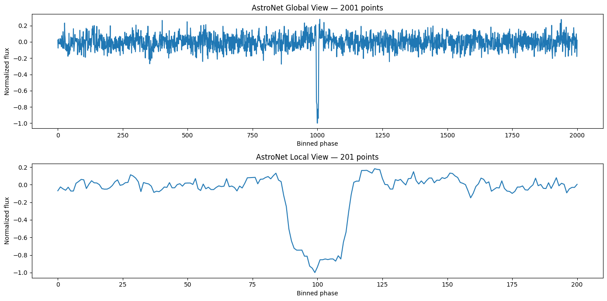
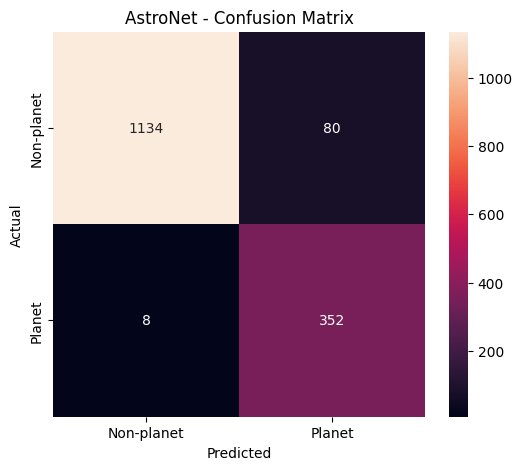
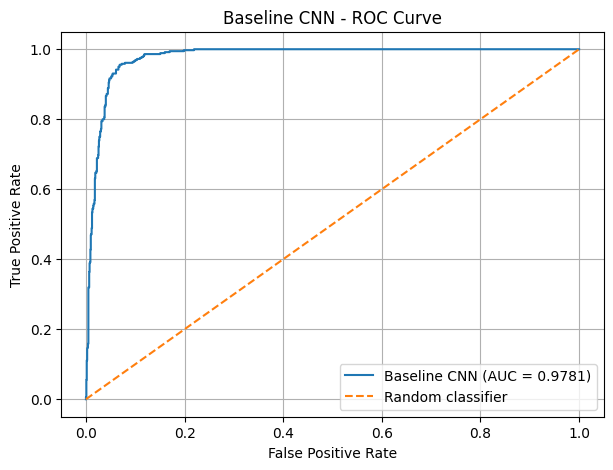
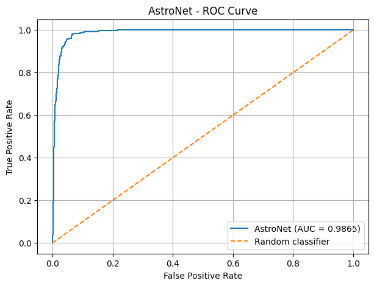
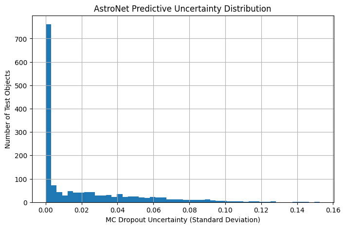
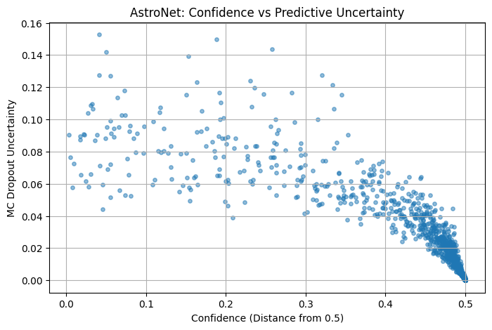
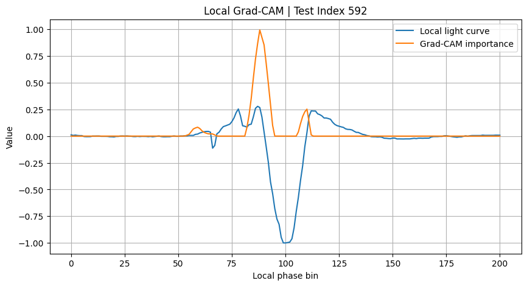

# Deep Learning Exoplanet Vetting from Time-Series Photometry

An AstroNet-style deep-learning pipeline for classifying Kepler exoplanet candidate signals using global and local phase-folded light-curve representations.

> **Research project** · Summer School of Astronomy & Astrophysics 2026  
> **Authors:** Kanishka Sharma and Kritika Sharma

---

## Overview

A transit-like dip in a stellar light curve is not automatically evidence of a planet. Eclipsing binaries, stellar variability, instrumental effects, and noise can produce similar patterns. This project investigates whether one-dimensional convolutional neural networks can help distinguish labelled planet candidates from non-planet signals.

The work compares a **baseline single-input 1D CNN** with an **AstroNet-style dual-input 1D CNN**. It also examines predictive uncertainty, model attribution, and probability calibration.

### What this project covers

- Binary classification of planet-candidate and non-planet examples
- Global and local light-curve representations
- Monte Carlo Dropout for approximate predictive uncertainty
- 1D Grad-CAM for model attribution
- Reliability-curve and Brier-score calibration analysis

## Results at a glance

| Metric | Baseline 1D CNN | AstroNet-style dual-input CNN |
|---|---:|---:|
| Accuracy | 91.61% | **94.41%** |
| Precision | 74.46% | **81.49%** |
| Recall | 96.39% | **97.78%** |
| F1-score | 84.02% | **88.89%** |
| ROC-AUC | 97.81% | **98.65%** |

On the held-out test set, the dual-input model reduced false positives from **119 to 80** and false negatives from **13 to 8**.

Detailed values are available in [results/model_comparison.csv](results/model_comparison.csv) and [results/case_studies.csv](results/case_studies.csv).

## Selected visual results

### Global and local input representations



The global representation contains 2,001 points and the local representation contains 201 points. The project uses the precomputed phase-folded representations distributed with the AstroNet dataset; raw Kepler FITS light curves were not independently phase-folded in the notebook.

### Confusion matrices

| Baseline 1D CNN | AstroNet-style dual-input CNN |
|---|---|
|  |  |

### ROC curves

| Baseline 1D CNN | AstroNet-style dual-input CNN |
|---|---|
|  |  |

### Uncertainty and explainability







See the `figures/` directory for the full set of original plots, including the most-uncertain-case views, Monte Carlo prediction distribution, and calibration curve.

## Dataset

The project uses the Kepler exoplanet candidate-vetting dataset distributed with the AstroNet project.

### Input representations

| View | Length | Purpose |
|---|---:|---|
| Global | 2,001 points | Broader light-curve context |
| Local | 201 points | Detailed transit-region morphology |

### Label mapping

| Original label | Meaning | Binary target |
|---|---|---:|
| PC | Planet Candidate | 1 |
| AFP | Astrophysical False Positive | 0 |
| NTP | Non-Transit Phenomenon | 0 |

### Dataset split

| Split | Samples |
|---|---:|
| Training | 12,589 |
| Validation | 1,574 |
| Test | 1,574 |
| **Total** | **15,737** |

Training-set label composition:

- PC: 2,885
- AFP: 7,643
- NTP: 2,061

> **Data provenance note:** The notebook consumes the already-generated global and local phase-folded examples. It does not independently create these representations from raw Kepler FITS files.

## Methodology

```text
AstroNet Kepler dataset
          |
          v
 Precomputed global + local views
          |
          +----------------------+
          |                      |
          v                      v
   Global 1D CNN          Local 1D CNN
          |                      |
          +----------+-----------+
                     |
                     v
                Concatenate
                     |
                     v
             Dense classification
                     |
                     v
             Planet probability
                     |
          +----------+-----------+
          |          |           |
          v          v           v
      Evaluation  MC Dropout  Grad-CAM
                     |       Attribution
                     v
              Uncertainty analysis
                     |
                     v
             Calibration analysis
```

### Baseline model

The baseline 1D CNN uses only the global light-curve view. Its documented architecture comprises Conv1D layers with 16, 32, and 64 filters, max-pooling, flattening, a 64-unit dense layer, and a sigmoid output. The reported parameter count is 1,012,545.

### AstroNet-style dual-input model

The main model processes the global and local views through separate 1D convolutional branches, combines their features, and applies a dense classification head with dropout. The reported parameter count is 8,135,361.

This is an **AstroNet-style adaptation**, not an exact reproduction of the original AstroNet implementation.

### Training configuration

| Parameter | Value |
|---|---|
| Framework | TensorFlow / Keras |
| Optimizer | Adam |
| Learning rate | 0.001 |
| Loss | Binary cross-entropy |
| Batch size | 64 |
| Epochs | 10 |
| Dropout | 0.5 |
| Class weights | Class 0: 0.6487; Class 1: 2.1818 |
| Training environment | Google Colab GPU |

## Evaluation and analysis

### Test-set classification

The AstroNet-style model's confusion matrix contains:

| | Predicted non-planet | Predicted planet |
|---|---:|---:|
| Actual non-planet | 1,134 | 80 |
| Actual planet | 8 | 352 |

### Predictive uncertainty

Monte Carlo Dropout was evaluated over **50 stochastic forward passes** per test example.

| Summary | Value |
|---|---:|
| Mean uncertainty | 0.02048 |
| Median uncertainty | 0.00375 |
| Maximum uncertainty | 0.15271 |

The most uncertain example is test index 592, with true label 0, mean predicted planet probability 0.45896, uncertainty 0.15271, and predicted label 0.

### Explainability

1D Grad-CAM was used to inspect regions of the input light curves that influenced model predictions. For test index 592, the local-view visualization shows activation around the central transit-like feature.

Grad-CAM is an attribution visualization; it is not evidence of a causal physical explanation.

### Calibration

The reported Brier score is **0.0441**. The reliability curve shows deviations from perfect calibration, including overconfidence in parts of the intermediate-to-high probability range.

## Repository structure

```text
deep-learning-exoplanet-vetting/
├── notebooks/
│   └── Deep_Learning_Exoplanet_Vetting_AstroNet.ipynb
├── figures/
│   ├── astronet_calibration_curve.png
│   ├── astronet_confusion_matrix.png
│   ├── astronet_roc_curve.png
│   ├── baseline_confusion_matrix.png
│   ├── baseline_roc_curve.png
│   ├── confidence_vs_uncertainty.png
│   ├── global_and_local_light_curves.png
│   ├── gradcam_local_test_592.png
│   ├── mc_dropout_predictions.png
│   ├── most_uncertain_global_view.png
│   ├── most_uncertain_local_view.png
│   └── uncertainty_distribution.png
├── results/
│   ├── case_studies.csv
│   └── model_comparison.csv
├── .gitignore
├── requirements.txt
└── README.md
```

## Getting started

### 1. Clone the repository

```bash
git clone https://github.com/kanishka3125/deep-learning-exoplanet-vetting.git
cd deep-learning-exoplanet-vetting
```

### 2. Create and activate a virtual environment

**Windows PowerShell**

```powershell
python -m venv .venv
.\.venv\Scripts\Activate.ps1
```

**macOS / Linux**

```bash
python3 -m venv .venv
source .venv/bin/activate
```

### 3. Install dependencies

```bash
python -m pip install --upgrade pip
pip install -r requirements.txt
```

### 4. Obtain the dataset

Obtain the required Kepler/AstroNet TFRecord dataset separately and make it available in your runtime. The raw dataset is not included in this repository.

### 5. Run the notebook

Open `notebooks/Deep_Learning_Exoplanet_Vetting_AstroNet.ipynb` in Jupyter or Google Colab. Update the dataset path in the notebook for your environment, then execute the notebook sequentially.

The notebook covers data loading, model training, evaluation, Monte Carlo Dropout, Grad-CAM, and calibration analysis.

## Limitations

- The model classifies labelled candidate examples; it does **not** independently confirm the existence of an exoplanet.
- The experiment uses the available Kepler/AstroNet dataset and may not generalize directly to other missions or stellar populations.
- The dataset is class-imbalanced.
- Monte Carlo Dropout provides an approximate uncertainty estimate, not a complete Bayesian posterior.
- Grad-CAM provides model attribution, not causal explanation.
- Application to TESS or other surveys requires additional validation.

## Future work

- Validate the pipeline on TESS data and other observational datasets.
- Evaluate on larger and more diverse candidate populations.
- Explore deep ensembles or Bayesian neural networks for uncertainty estimation.
- Investigate additional explainability methods.
- Explore multiclass classification and more automated candidate vetting.

## References

1. Shallue, C. J., & Vanderburg, A. (2018). *Identifying Exoplanets with Deep Learning: A Five-Planet Resonant Chain around Kepler-80 and an Eighth Planet around Kepler-90*. The Astronomical Journal, 155(2), 94.
2. Koch, D. G., et al. (2010). *Kepler Mission Design, Realized Photometric Performance, and Early Science*. The Astrophysical Journal Letters, 713(2), L79–L86.
3. Gal, Y., & Ghahramani, Z. (2016). *Dropout as a Bayesian Approximation: Representing Model Uncertainty in Deep Learning*. Proceedings of ICML, 48, 1050–1059.
4. Selvaraju, R. R., et al. (2017). *Grad-CAM: Visual Explanations from Deep Networks via Gradient-Based Localization*. Proceedings of ICCV, 618–626.
5. Guo, C., Pleiss, G., Sun, Y., & Weinberger, K. Q. (2017). *On Calibration of Modern Neural Networks*. Proceedings of ICML, 70, 1321–1330.

---

## Authors

**Kanishka Sharma** · **Kritika Sharma**  
SRM Institute of Science & Technology, Chennai

If you use or build upon this work, please cite the project repository and the original references above.
